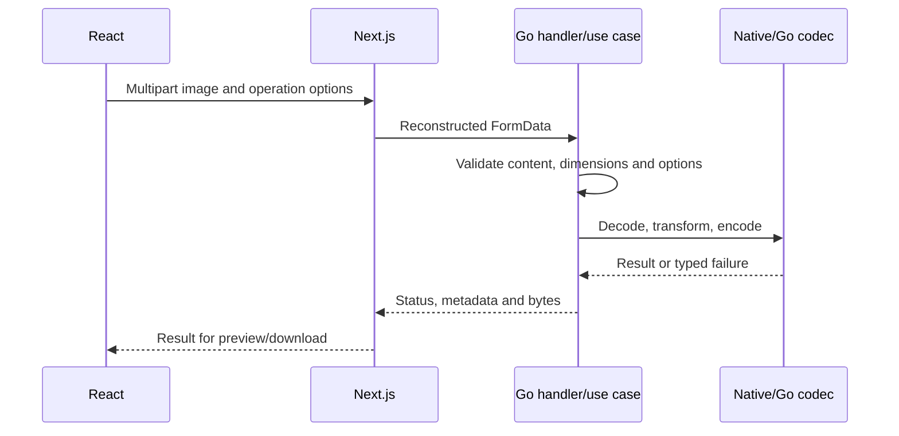

# Trace an image from browser to codec

Static review: 2026-10-18 at `2c9a27f40a2a2c8bef5f86f187256870c1960630`. This independent Go/Next.js project serves developers studying synchronous binary HTTP processing. It compresses, resizes, converts and generates previews without durable uploads, jobs or a database. [Docker installation](../docker/runtime.md), [development dependencies](../docker/development.md) and [codec ADR 001](../adr/001-native-image-codecs.md) describe the supported native build.

## Request and resource lifetime

React keeps the original `File`, settings and result/preview blobs. Next.js `/api/images/*` routes rebuild multipart requests and forward them to Go using server-side `BACKEND_URL`; the browser does not address the Compose backend hostname. `backend/internal/infrastructure/http/router.go` constructs operation use cases and concrete codec adapters. Inspection returns metadata; processing returns bytes. Download bytes and fallback preview bytes are different artifacts.

`router.go` exposes health, compression, resize info/process, conversion info/process and preview. [API contracts](../api/contracts.md) describe error/status differences. Compression bounds the whole multipart body at 50 MiB; 8 MiB is a multipart memory threshold, not a decoded-image limit. Shared imaging limits include 32 million decoded pixels and 64 million animation frame-pixels. Encoders, input copies, proxy `ArrayBuffer` and simultaneous requests can exceed a single-frame estimate. There is no global admission semaphore or durable queue.

CGO/libheif/plugin compatibility is a deployment dependency, not optional browser capability. An input extension/MIME is not proof of the actual format; unsupported family, unsupported variant, corrupt bytes and resource excess are distinct cases. Resizing can increase encoded byte size. Animation, alpha, orientation and metadata need the operation-specific format matrix rather than a universal “lossless” claim.

## Failure and operation

The proxy propagates abort, but native work does not necessarily stop immediately. Proxy exceptions return 502; backend errors retain their mapped status. A retry performs new work; there is no result-history/idempotency service. Multipart spill files and browser object URLs have separate cleanup lifetimes. No authentication, rate limits, public TLS or user isolation is implemented here. Local synchronous processing is the delivered scope.

Install Docker/Compose with native packages built by the Dockerfiles; run `docker compose up --build backend frontend` from this repository. UI defaults to localhost:3000 and API localhost:8080. For an existing checkout use the dependency/recovery guide rather than deleting volumes or caches blindly. The command is guidance only; nothing was started during this review. Tests and real-image fixtures are described in [strategy](../testing/strategy.md); no Go, native codec or browser suite was run now.

## Interview rehearsal

**Introductory — Why separate conversion from preview?** Conversion defines the downloadable result; preview may use a browser-friendly fallback that is not that result. Follow-up: compare result media type, oriented dimensions and download bytes before presenting savings.

**Intermediate — Why keep interfaces around codecs?** Use cases can validate policy and be tested with controlled adapters while native infrastructure owns format behavior. Follow-up: fake tests cannot demonstrate libheif availability or fidelity; real fixtures exercise selected formats, not every possible image.

**Challenging — Does a 50 MiB limit prevent memory exhaustion?** No. Compressed bytes, decoded canvases, animation, native buffers, response copies and concurrency have different bounds. Follow-up: measured peak memory/admission experiments would be required before sizing production; a hypothetical worker queue changes user-facing completion semantics and does not itself bound codec memory.

Evidence gaps: concurrent peak memory, hard interruption of native codecs, broader browser/visual coverage and production exposure. Existing historical race/checkptr limitations remain in the testing documentation. No throughput or production outcome is inferred.
