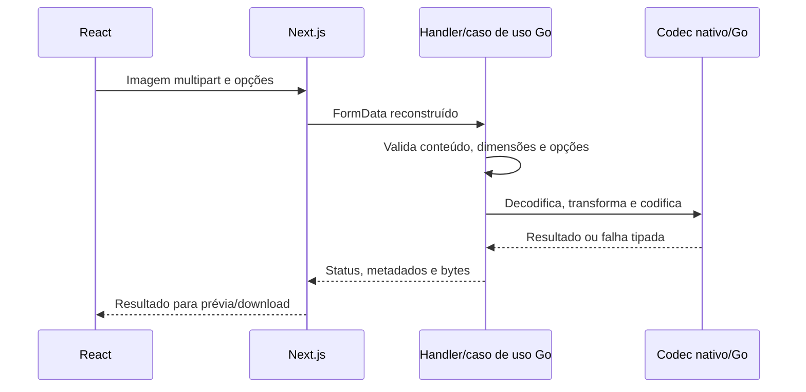

# Acompanhe uma imagem do navegador ao codec

Revisão estática: 2026-10-18 em `2c9a27f40a2a2c8bef5f86f187256870c1960630`. Este projeto independente em Go/Next.js atende desenvolvedores estudando HTTP binário síncrono. Comprime, redimensiona, converte e gera prévias sem uploads duráveis, jobs ou banco. [Instalação Docker](../docker/runtime.md), [dependências de desenvolvimento](../docker/development.md) e [ADR 001 dos codecs](../adr/001-native-image-codecs.md) descrevem o build nativo suportado.

## Requisição e vida dos recursos

React mantém o `File` original, configurações e blobs de resultado/prévia. Rotas `/api/images/*` do Next.js remontam multipart e encaminham para Go com `BACKEND_URL` no servidor; o navegador não acessa o hostname interno do Compose. `backend/internal/infrastructure/http/router.go` constrói casos de uso e adaptadores concretos. Inspeção devolve metadados; processamento devolve bytes. Download e prévia alternativa são artefatos diferentes.

`router.go` expõe health, compressão, inspeção/processamento de resize, inspeção/processamento de conversão e prévia. [Contratos da API](../api/contracts.md) explicam diferenças de erros/status. Compressão limita todo o corpo multipart a 50 MiB; 8 MiB é limiar de memória multipart, não limite da imagem decodificada. Limites compartilhados incluem 32 milhões de pixels decodificados e 64 milhões de pixels-quadros de animação. Encoders, cópias de entrada, `ArrayBuffer` do proxy e requisições simultâneas podem exceder a estimativa de um quadro. Não há semáforo global de admissão ou fila durável.

Compatibilidade CGO/libheif/plugins é dependência de implantação, não capacidade opcional do navegador. Extensão/MIME não prova formato real; família não suportada, variante não suportada, bytes corrompidos e excesso de recursos são casos distintos. Resize pode aumentar o tamanho codificado. Animação, alpha, orientação e metadados exigem a matriz específica da operação, sem promessa universal de ausência de perdas.

## Falhas e operação

O proxy propaga abort, mas trabalho nativo pode não parar imediatamente. Exceções do proxy retornam 502; erros do backend preservam seu status mapeado. Retry executa novo trabalho; não há histórico/idempotência de resultados. Temporários multipart e object URLs do navegador têm limpezas separadas. Autenticação, rate limits, TLS público e isolamento por usuário não estão implementados. O escopo entregue é processamento síncrono local.

Instale Docker/Compose; Dockerfiles constroem os pacotes nativos. Execute `docker compose up --build backend frontend` neste repositório. UI padrão localhost:3000 e API localhost:8080. Em checkout existente siga o guia de dependências/recuperação antes de apagar volumes ou caches. O comando é orientação; nada foi iniciado nesta revisão. Testes e fixtures reais estão na [estratégia](../testing/strategy.md); nenhuma suíte Go, nativa ou de navegador foi executada agora.

## Preparação para entrevista

**Introdutória — Por que separar conversão e prévia?** Conversão define o download; prévia pode usar formato alternativo compatível com o navegador. Aprofundamento: compare media type, dimensões orientadas e bytes do download antes de apresentar economia.

**Intermediária — Por que interfaces para codecs?** Casos de uso validam políticas com adaptadores controlados em testes; infraestrutura nativa controla o formato. Aprofundamento: fakes não demonstram disponibilidade do libheif nem fidelidade; fixtures reais exercitam formatos selecionados, não toda imagem possível.

**Desafiadora — Limitar 50 MiB impede esgotamento de memória?** Não. Bytes comprimidos, canvases decodificados, animação, buffers nativos, cópias de resposta e concorrência têm limites distintos. Aprofundamento: dimensionamento de produção exigiria medir picos/admissão; uma fila hipotética muda a conclusão percebida pelo usuário e não limita sozinha a memória do codec.

Lacunas: pico de memória concorrente, interrupção forte dos codecs, cobertura visual/navegadores e exposição em produção. Limitações históricas de race/checkptr continuam na documentação de testes. Não se infere vazão ou resultado de produção.
